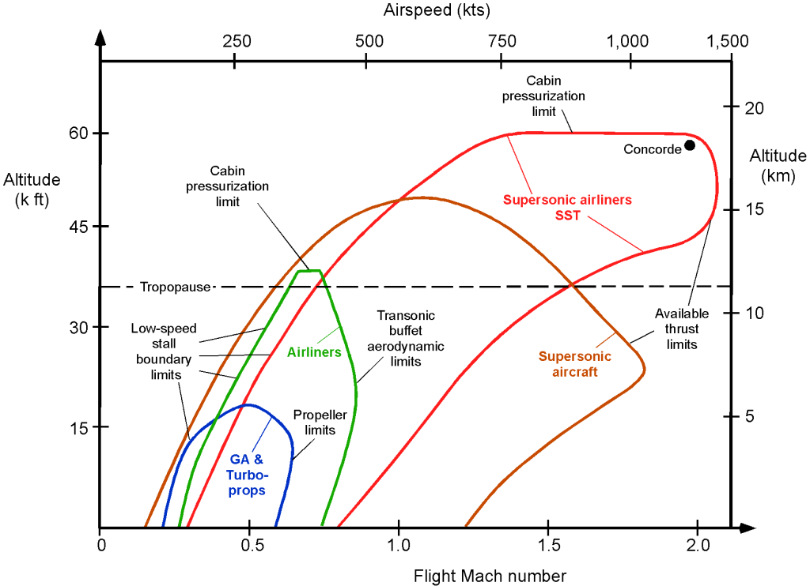

+++
date = '2025-03-25T13:55:56Z'
draft = false
title = 'Aircraft Structural Weight Estimation'
summary = 'Welcome to the first article in a series I’m writing on Structural Weight Estimation for Aircraft! This will be a series on indeterminate length, with a highly irregular release schedule!'
tags = ['weight-estimation', 'aircraft-design', 'sweep']
featured_image = 'cover.png'
+++

*Originally published on [LinkedIn](https://www.linkedin.com/pulse/aircraft-structural-weight-estimation-benjamin-crews-nwxae/).*

Welcome to the first article in a series I'm writing on Structural Weight Estimation for Aircraft! This will be a series on indeterminate length, with a highly irregular release schedule! I'm writing up this series to give background on the topic and introduce a personal project I've been working on.



(I highly recommend Raymer's texts. If you're interested in this, please check out his book(s): [https://aircraftdesign.com/aircraft-design-a-conceptual-approach/](https://aircraftdesign.com/aircraft-design-a-conceptual-approach/))

The estimation of aircraft weight is a critical part of the conceptual design process. The structural weight makes up a large portion of the total vehicle weight, and has the highest penalty to performance. In the conceptual phase, configuration synthesis and optimization involves a lot of complex, interdependent trade studies. Traditional weight estimation methods involve a series of statistical factors and vehicle configuration parameters, to account for effects of airloads, maneuverability requirements, advanced materials, and flight speeds. These balance increasing mathematical and statistical complexity with increasingly accurate estimates.

At a certain point in the design cycle, structural designers start asking questions like "Is a stringer or longeron system more efficient? How close do these frames *really* need to be? What's the weight tradeoff of this wing being mid-fuselage mounted vs bottom-mounted? How much weight gets added to the fuselage when we add an active sweep mechanism into the wing?" These questions are all quite complicated to answer and often require a (team of) Stress Engineer(s) to conduct detailed analysis studies over a much longer period of time than a simple factor lookup and summation of line items. And yet, these can be very important questions to the overall design! Sometimes, teams can rely upon the expertise of those that came before, but that's not always correct and not always available. This is the area where I see opportunity, but also historical precedent...

To further complicate matters, structural weight is one of the most highly configuration-sensitive parameters in the aircraft. If you've ever been involved in conceptual design (or maybe taken a vehicle synthesis class) you'll be well versed in the complex interactions of landing gear and wing placement. It's virtually impossible to separate configuration and structural synthesis! Despite the importance, structural weight has traditionally been one of the most difficult parameters to accurately predict. Modern structural tools like coupled FEA+Sizing solutions can greatly help expedite the weight estimation process, but the loops are still labor intensive.

Enter Rockwell International Inc. and their *"Structural Weight Estimation Program (SWEEP) for Aircraft" (1974).* The documentation is extensive, and the kind of work that you just don't see published anymore. Rockwell's team built a full FORTRAN set of applications to provide structural weight predictions of advanced aircraft, with heavy emphasis on higher flight speeds and variable wing sweeps (the wing volume alone is 3 books with 6 appendices!). For those well versed in aviation history, you can probably already see where this is headed, but for others here's a fun piece of trivia: What prototype aircraft with a high top speed and variable sweep wings first flew around Christmas of 1974?



> \[...\] the risk is high of adopting a less than optimum basic configuration at the very inception of a program, adversely affecting system effectiveness throughout the life of the design.

To use existing methods, you *need* derived statistical parameters, relevant to **your** mission and flight profiles. What if you start pushing the limits beyond the data collected? Fly higher, fly faster, pull harder g's, or even fly into the realm where thermomechanical effects begin to drive the structural sizing. You need an analytical solution instead of statistical one; or perhaps you could iteratively build planes on the fringe of your dataset and proceed to collect more data each time: Essentially start over from the 1950's. In modern times AI/ML and Large Language Models are commonly used in place of statistical derivations and factors, but these have the same problem.

To build something beyond the existing dataset, you extrapolate beyond the bounds of applicability, and assume the trends continue. Maybe they do, but a physics-based approach will give more confidence in the estimates. Additionally, when studying vehicle synthesis, you'll want to investigate the causal relationships between systems and requirements, and reflect the actual operating environment of the vehicle (gust loads, life requirements, temperatures, etc).

In the next article, we'll go through how Rockwell's team broke down this process, and what happened to the code. If they built it, why don't we use it...? And how does this approach compare to the modern sizing phases of Preliminary Airframe Design?
