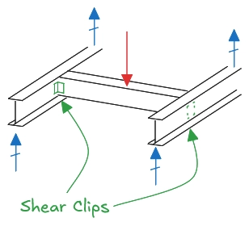
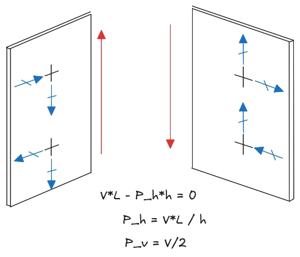
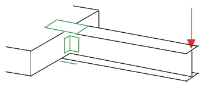
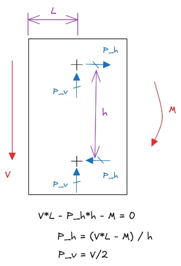
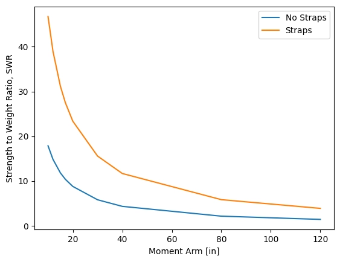

+++
date = '2026-05-20T00:48:17Z'
draft = false
title = 'Back to Basics: Shear Clips'
summary = 'A couple years ago, I was working with a friend of mine on a wing design. He had about 10 years of experience at the time, and I had maybe 8.'
tags = ['stress-analysis', 'fundamentals']
featured_image = 'cover.png'
+++

*Originally published on [LinkedIn](https://www.linkedin.com/pulse/back-basics-shear-clips-benjamin-crews-gproe/).*

A couple years ago, I was working with a friend of mine on a wing design. He had about 10 years of experience at the time, and I had maybe 8. Both of us stress engineers; analytical minds, experienced in the minutia of Greek letters and names of old (mostly) dead dudes. We worshipped Bruhn and Niu, envied Flabel, and waxed philosophical over Peery. At a certain point, he called me over to his desk and looked a little worried (but still smiling as usual, somehow). He had a shear clip design up and explained how he was being asked to remove the cap splices, or prove that he needed them. We both knew it was a poor design practice, but if “engineering judgement” doesn’t stand you have to resort to good ole first principles.

Look, I love fundamentals and engineering first principles… but in this scenario there were two things true at once: collectively, we had enough experience to know “good” design would be a more robust solution, but we also didn’t have a strong enough way to communicate *why* this design was “good” and the math showing it was necessary.

And you may be reading this now thinking “it’s a shear clip… how were you stumbling?? I’m not interested in any technical advice from some idiot on the internet that doesn’t know how to analyze a shear clip!” and that’s fair… but also, I hope that after reading the rest of this you’ll agree that picking apart even some basic fundamentals can further your own understanding. And more recently, I was asked about a similar situation which resolved into the exact same confusion and discussion around shear clip fundamentals. Over different conversations we had multiple stress engineers of various experience levels struggling through this, and not a single one immediately had the solution. Sometimes things that act as clips don't initially look like clips. Sometimes you have questions that start with "why," and running the canned method or pulling up the template doesn't give you any closure. So here’s the problem.



### In Their Simplest Form

Before we break that down, let's review the source. The shear clips section in Bruhn is D3.2, written by William McCombs, and titled “Important Structural Details.” Important indeed! McCombs states **a core assumption is that the clip only transfers shear.** When “a significant moment must be transferred across the joint” a secondary means such as a fitting or splice plates must be used. The basic example is an I-beam connected at each end to perpendicular I-beams. It looks something like this…



So if we assume the beam in the middle is pinned at both ends, no moment. And then the FBD for the shear clip can be drawn.



The applied load is again assumed to act at the corner of each leg of the clip. Each leg must be in static equilibrium, so the offset from the fasteners to the corner generates a moment, balanced by the horizontal fastener loads. These horizontal loads are a secondary effect of the eccentricity, and very real. If you only have one fastener, you've created a hinge! Maybe you can hold some load with friction, but that’s not a very reliable reaction mechanism. It’s strongly advised to ignore beneficial effects of friction in aerostructures design.

### Putting Moment Across the Joint

So then going back to our first example, the immediate violation here is an assumption of applied moment. McCombs says that you always assume it's negligible. Well… what happens if I don't follow good design practice and I put moment into my clip? First, ask yourself “*How* does the moment get into the clip?”



What happens if we take the splices off the top and bottom in the above image?

There's only one answer: horizontal fastener loads. We can draw this FBD again, but with applied moment resolved to the same fastener loads.



We can see that the moment will either alleviate or compound with the secondary loads of the clips moment arm.

So if you put moment into a clip, you'll overload your fasteners and probably fail at the joint before anything else happens. Moments in the beam are typically compared to the total beam cross-section (the height/depth) of our I-beam. Clips are typically shorter, and then the fasteners are spaced from the edges of the clip to avoid tearing the clip ligament (usually minimum 2.0\*fastener diameter). So the “h” in the above diagram is slightly shorter than the capability of the beam. You’ve designed a joint that **severely** limits your total load capability and will always carry extra “dead” weight! Your beam height is no longer based on the the beam’s required bending strength. Now, it’s based on the fastener spacing in your clip and the edge distances and spacing you’re willing to accept.

But let's keep being silly as a thought experiment and see what other failure modes there are… we've also got tensile loads on the opposing clip. We've made the classic blunder of assuming a clip is in shear when in reality it's in tension! Now, we have to perform a tension clip analysis or flange bending check. I won't go into details, but you get significantly less capability here. Reference D3.3 for more guidance from McCombs.

A final thought: What about the torsion? This is where we really started to stumble in my opening example. If we can take the flange bending and the fastener loads, isn't there also some torsion on the clip section? Yes and no. There are some size-based underlying assumptions here. “Clips” are simple members. They are typically either an “L” or “T” shape, and made from either sheet metal or extrusion (or you can make them from various composites methods). In all cases, when a structural analyst talks about a “clip,” they’re talking about something small and simple. In order to get the thickness and fastener diameters where you can withstand significant loads that produce torsion, you aren't really in the realm of a “clip” anymore. You've accidentally stumbled into what McCombs told you to do earlier: you made a discrete fitting! Oops, you accidentally used first principles to follow good design practice, but we had to do a lot of math to get here instead.

### An Example

Let's clarify with an example. All of these numbers and material values are completely made up, but somewhat representative of values you might find.



We can easily solve this based on the formulas outlined above. Note we’re using the blend radius of the I-beam with a nominal offset and standard edge distance to get the clip height from before. This setup puts a massive moment into the base. A shear clip with 2 fasteners simply can’t react this load… But with splices on top (sometimes I call them straps, sorry), we can still easily get positive margins.

```text
Clip Only
====================
 f_b  = 59.0 [ksi] (beam)
 f_br = 1518.6 [ksi] (clip)

 MS_b  = +0.22
 MS_br = -0.93

Weight = 0.048 [lbs]
SWR    = 1.4

With Straps
====================
 f_b  = 59.0 [ksi] (beam)
 f_br = 29.9 [ksi] (clip)
 f_a  = 37.0 [ksi] (strap)

 MS_b        = +0.22
 MS_br_clip  = +2.47
 MS_br_strap = +0.05
 MS_t        = +0.94

Weight = 0.270 [lbs]
SWR    = 3.9
```

Those last values in the output are a rough strength to weight ratio. I factored up the applied load based on the margin and divided by the joint weight. In this configuration, we can see the Cap Splice version is heavier, but has double the SWR and *crucially* a positive margin. Our clip could actually be sized *down* here quite a bit, saving even more weight. This reflects the load path of the part: high moment, low shear. We put the weight where it counts, in the most efficient manner.

What happens if we change the moment, but keep the shear and geometry constant? Here’s a simple sweep comparing the two:



I wouldn’t put too much stock into this, because it’s only a single configuration, but it’s a useful illustration that the straps will always be more efficient to transfer moment than a clip. Code for this example can be found [here](https://gist.github.com/Czarified/0bef8f763d68b22b9fac8e6a3d7f4a4d).

### Summary and Conclusion

Shear clips are deceptively simple structural elements that require careful attention to fundamental analysis principles. The core assumption in shear clip design is that these components transfer only shear loads, with any significant moment requiring additional structural elements like fittings or splice plates. When designers violate this principle by introducing moments into clips, they create a cascade of problems: fastener overloading due to compounded secondary loads, potential clip tension failures, and inefficient designs that carry unnecessary weight while severely limiting load capability.

The lesson here isn't just about shear clips - it's about returning to first principles when intuition alone can't justify design decisions, and giving yourself (and each other) both the permission to think deeply about it and the time to figure it out. Even experienced engineers benefit from working through the fundamentals: load paths, free body diagrams, and failure modes. What looks like a simple component becomes complex when you ignore proper design practices, ultimately proving that McCombs' guidance in Bruhn wasn't arbitrary. He understood these exact failure mechanisms. Similarly, blindly pushing "light weighting" or “best part is no part” practice without truly understanding *why* good design practice is "good" can lead to inefficient solutions and unfounded confidence. You might save a few grams on paper while creating a design that's structurally compromised, impossible to manufacture/assemble reliably, or critical in new unknown failure modes. Sometimes the best engineering solution is the most straightforward one: when you need to transfer moment, use a fitting designed for that purpose and let your clips stick to their day job.

Footnote: I'm referencing the 1973 edition of Bruhn. If you have an earlier copy, the sections may be different.

---

Enjoyed this article? Like my work? Buy me a coffee on **[Ko-fi](https://ko-fi.com/Q5Q81SFNBW)**! ☕
