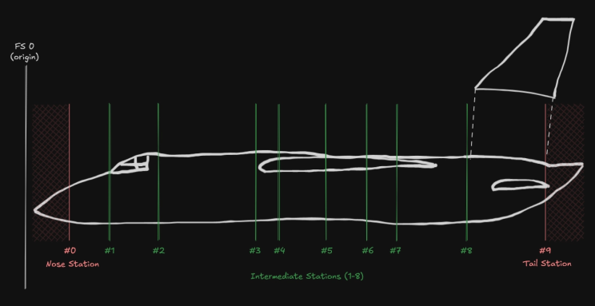
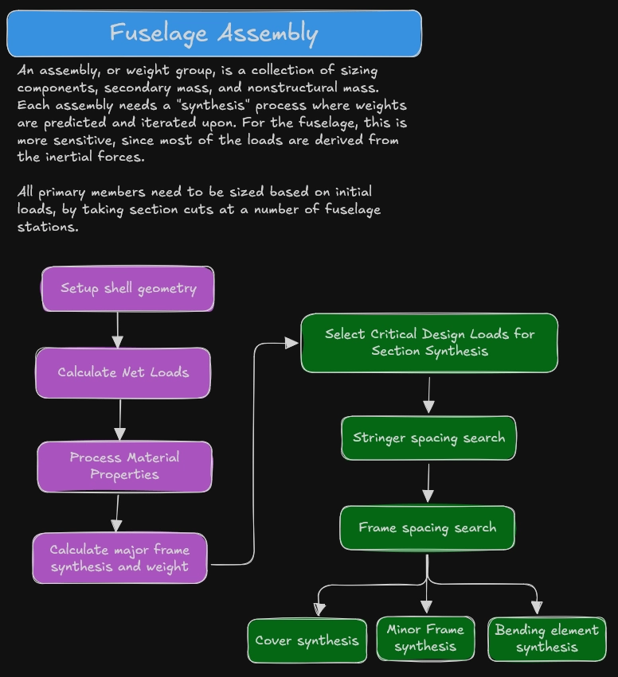
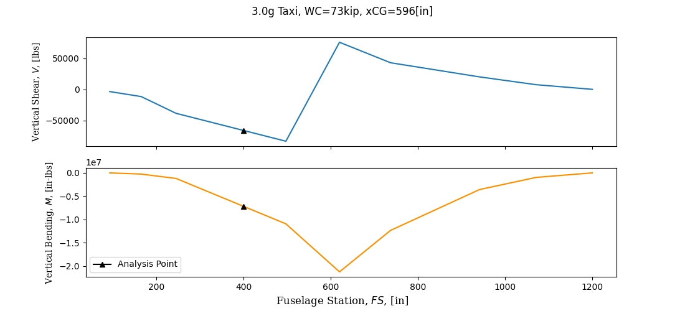
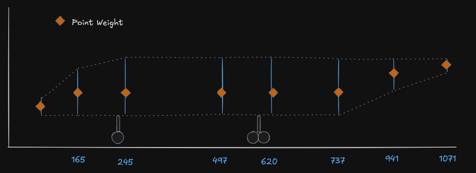
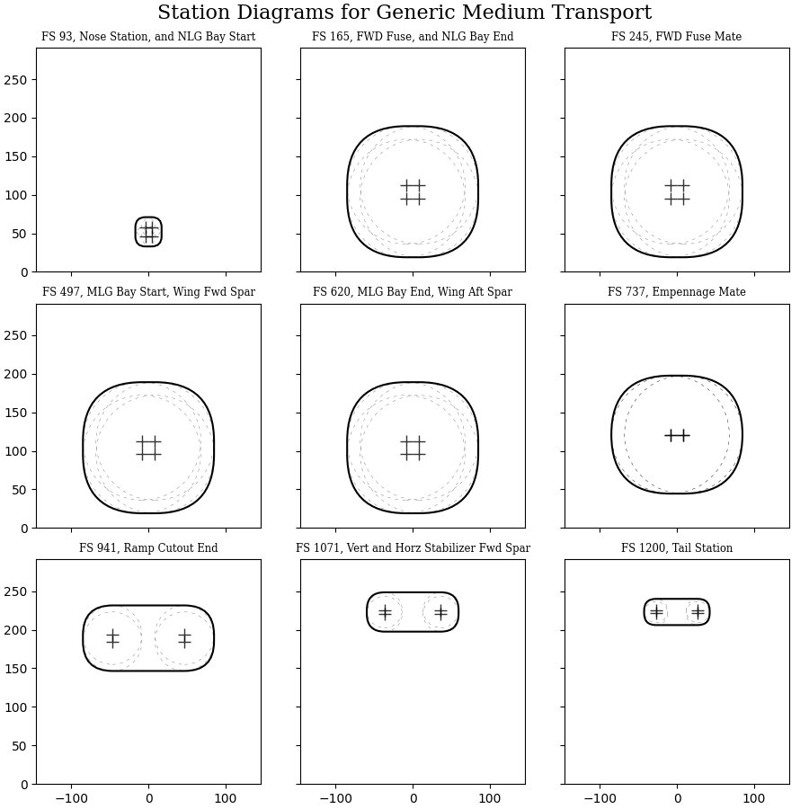
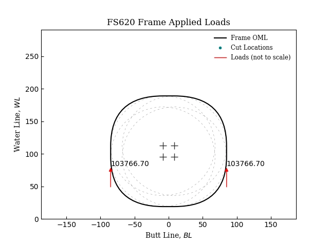
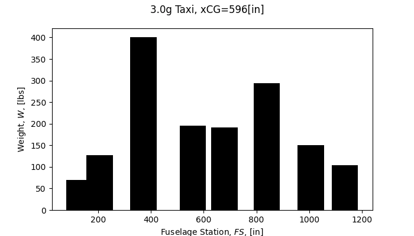

+++
date = '2026-08-11T00:49:09Z'
draft = false
title = 'Dev Blog: Fuselage Synthesis'
summary = 'This is part 3 of a long-running series I’m collecting on Aircraft Weight Estimation and Prediction. Parts 1 and 2 explored the problem and the general approach.'
tags = ['weight-estimation', 'hyperstruct', 'python', 'dev-blog']
featured_image = 'cover.png'
+++

*Originally published on [LinkedIn](https://www.linkedin.com/pulse/dev-blog-fuselage-synthesis-benjamin-crews-pm9ce/).*

This is part 3 of a long-running series I’m collecting on Aircraft Weight Estimation and Prediction. Parts [1]() and [2]() explored the problem and the general approach.

## Background

Many years ago, I was searching for some reference material on weight-optimum aircraft structural layout. I was working for a startup and tasked with turning a blank sheet of paper into a full airframe. Weight wasn’t the main driver on this project, but knowing the way aircraft programs go, I knew it would eventually be important. You can look up all kinds of cutaway diagrams for aircraft and pick up on similar concepts. There are layouts that use wing ribs parallel to the airstream, or ribs perpendicular to the spars (which can be different when you have wing sweep). There were concepts with stringers and others with longerons. I could go on… Specifically, I was trying to justify where I really needed frames on a longeron system, and how few I could get away with. Fewer frames, fewer parts to release, but would it actually be lighter?

Through this research I discovered SWEEP, the North American/Rockwell aircraft structural weight sizing program. I was fascinated by the complexity and impressed with the level of detail. I wanted to make my own, but I knew this would be a *massive* undertaking. Nevertheless, I created a new repo and kicked off the largest passion project I’ve ever been a part of. Given my immediate fascination with the fuselage, I wanted to focus on it first. The fuselage is quite a complex structural group, so I figured it was probably either the hardest or second hardest piece to sew together (programmatically).

Recently, I pushed the final commit for v0.1.0 of hyperstruct. This release will mark the first time that I have a functional Fuselage module and represents multiple years of Friday/Saturday mornings reading 50 year old documents and manually translating them into Python. The source code in these scans in illegible, so I had to start from scratch. However, I wanted to keep as much of the core principles the same or similar. So now, I want to document some of the details around the development and theory for fuselage synthesis within hyperstruct.

## Fuselage Synthesis

So what *is* “synthesis?” This is a question I asked in grad school when I signed up for some weird class called “Flight Vehicle Synthesis” at UTA (thanks Dr. Chudoba, it was a great class!). Essentially, synthesis is the activity of collecting design inputs from a systems level. We aren’t looking at anything in a vacuum. This is the approach you have to take early on in conceptual design. SWEEP however, uses the word “synthesis” to describe the high level **structural** collection. So in my program I use this word to mean:

> The analysis approach of sizing all child members in the collector, and propagating their structural effects and contributions into the parent. The recursive and iterative process of applying loads, calculating weights, resizing, and repeating until convergence.



Fuselage synthesis involves *many* inputs. We walk the line between analysis fidelity and practicality. The purpose of synthesis is providing a detailed weight breakdown and understanding of the structural sensitivities. We want to know whether our layout is overly sensitive to a specific loadcase, directly proportional to increases in load, and/or predominately carrying weight in one particular region or family of structural members (and does that concentration make sense). To do this without abstracting away too much, we have to have definitions for geometry, layout, loadcases, materials, stress methods, and more.

The process is roughly:

1. Setup the shell geometry
2. Calculate net loads
3. Process material properties (or skip if unnecessary)
4. Size the major frames
5. Use multi-section shell analysis to size Stringers/Longerons and spacing Minor frames and frame spacing Skins (or “covers”)

### Two Analysis Methods

There’s generally two analysis steps above: Discrete frame sizing, and Multi-section. This derives from some assumptions in the overall method. Frame components are broken down into two classes (literally): Major and Minor.

### Major Frames

Major Frames are sized to redistribute loads from external components supported by the fuselage. Major Frames are how much of the load gets *into* the fuselage itself. The “external components” can be landing gear, wing attachments, nacelle attachments, horizontal/vertical stabilizers, or really anything else. As such, we assume that they are dominated by their own local loads. We don’t interact their local loads with global shear/bending. This is likely unconservative and represents the first generalization that makes this program insufficient for more detailed sizing. However, as a tool for the conceptual/preliminary phases or for academic study, this is perfectly fine.

The general approach for Major Frames is:

1. Define the geometry
2. Determine sizing cuts around the periphery
3. Calculate internal ring loads at the midpoint of each ring segment
4. Size the ring elements
5. Calculate the weight

### Minor Frames and Multi-Station Shell Synthesis

Minor Frames are all the rest of the rings on the fuselage. They form the basic structural “grid” that resists the global shear/bending loads. As opposed to Major Frames, Minor Frames do not re-distribute concentrated loads. They are sized as part of the shell structure and interact with the Covers and Longerons.

To perform the Minor Frame analysis, we inherently need to consider the rest of the structure. The fuselage can be broken down into multiple segments. In general, you can do this as much as you like. For each segment, you have a number of Minor Frames at some spacing (like 5 inches between frames for the first segment, but 7 inches in the next segment). These segments are separated by arbitrary station numbers, and would look something like this:

The regions forward of Station #0 and aft of Station #9 are not considered in the program, since they don’t contribute to the overall strength.

Within each segment, we calculate the spacing (or just give a single number if you already know it), then use those spans as inputs for the Cover, MinorFrame, and Longeron sizing. The stability and post-buckling methods (if you’re using it) require this span input and it’s usually critical. Within each of those we can size up the cross-section and calculate the weight.

Longerons and MinorFrames are analyzed as beam structure. They take primary load input from the fuselage net loads, as well as secondary input from the forced crippling. Longeron area is simply scaled, and we ignore any net section reduction from fastener holes or clearance cutouts. Again, this is something that must be factored in for detailed design and *will* have an impact on the final weight, but just infeasible at the scale of the program here.

Covers (skins) are sized as membranes. They take in primary shears from the fuselage net loads as well as secondary shear and tension from the forced crippling. This is generally Bruhn/NACA-TN-2611 and modified for weight output instead of writing margins directly. Covers are also analyzed for secondary structural phenomenon, like Panel Flutter and Acoustic Fatigue. These methods take additional inputs like the flight condition Mach and Altitude or the acoustic life material data.

Putting all that together into a diagram we get something like the figure below. I drew it as a simple feed-forward linear diagram. In reality this is a looping procedure. Each search method iterates on it’s own, and then at the end sizing uses all the values found for the full-up weight tabulation. Additionally, this process has to happen **for each loadcase.**

## Loads and Loadcases

I mentioned loadcases and fuselage loads in the previous paragraphs. The fuselage uses Net Loads. Loads inputs include everything on the aircraft: aerodynamics, control moments, landing gear, inertia, etc. The fuselage is generally assumed to act like a beam, and we can build up a shear moment diagram just like undergraduate mechanics of materials. I call this a VMT (Shear-Moment-Torsion), but notably the program excludes fuselage Torsion. I’m not sure whether SWEEP originally included this or not, I’d have to dig back into the reference material. It’s something I think should be included, but for now I oversimplify and put no torque on the tube. Additionally and in line with SWEEP assumptions: the effects of lateral shear and bending are excluded. These lateral forces are the ones that would deflect the fuselage in a curve looking from the top down, instead of from the side (the vertical bending).

From the VMT, we can interpolate to get the fuselage shear and moment at any station, and use those global loads as inputs for local sizing. This diagram and collection of loads is what I call the *Net Internal Loads* or Net Loads. We can have aero pushing up on the nose, the inertia pulling down, and then push up on the landing gear to simulate a landing condition. The net combination of all those is the VMT.

In the program, these and all other loads inputs are collected into a Loadcase class. The Loadcase has the net loads table, the flight conditions (things like the Mach, Altitude, and Load Factors), as well as some general information like a name and description. We need this collector because it helps us reference and keep track of all the information and we pass it around in the synthesis routine. Additionally, we can use one top level collector for all the airframe weight groups (Fuselage, Wing, Empennage, Landing Gear, Air Induction, etc).

## Conclusion

This is the general state and background information on the synthesis approach within hyperstruct. The current release is at a “functional” level, but no where near accurate. I focused on the procedure and getting all the pieces and data flow to work. The weight estimates are highly unrealistic, and that’s in part due to complications with the forced crippling methods. I’ve also oversimplified or hard-coded some things temporarily. Next steps for the fuselage are figuring out why many areas are under-predicting, or for the longerons simply not calculating weight at all. However, now that it’s stitched together, I can at least debug a grounded problem.

So setting up an example medium transport aircraft. We can draw something like this.

Which can then be translated into station geometries like this:

Notice those frames aren’t pure circles, and in the tail region we transition to a much more boxy OML. Next, set Major Frames at the Landing Gear Locations with local load introductions at the gear attachment points. This provides the landing gear loads input for ground conditions. Here’s the MLG:

After running the synthesis routine we can generate a bar graph of the equivalent concentrated weights coming out of the sizing. Again, these are wrong and I know that. The focus is on the method and capabilities, not the specific result.

Our structural weight is concentrated near the landing gear and the bays between them. That passes an immediate sanity check, although we know the longerons are going to be major contributors to the bending reaction, and they aren’t included here… So… 🤷

Moving forward, I think I’m going to take a break from the fuselage and work on something that is *hopefully* much simpler to structurally size, before returning back and ironing out the realism of these predictions. This is all for fun, remember! 😆 My friends have told me “Boy you really know how to party, don’t you!”

---

☕ Thanks for reading. If you enjoyed my work, you can [buy me a coffee](https://ko-fi.com/Q5Q81SFNBW)! Any caffeine donations will be used as developer fuel! ☕
