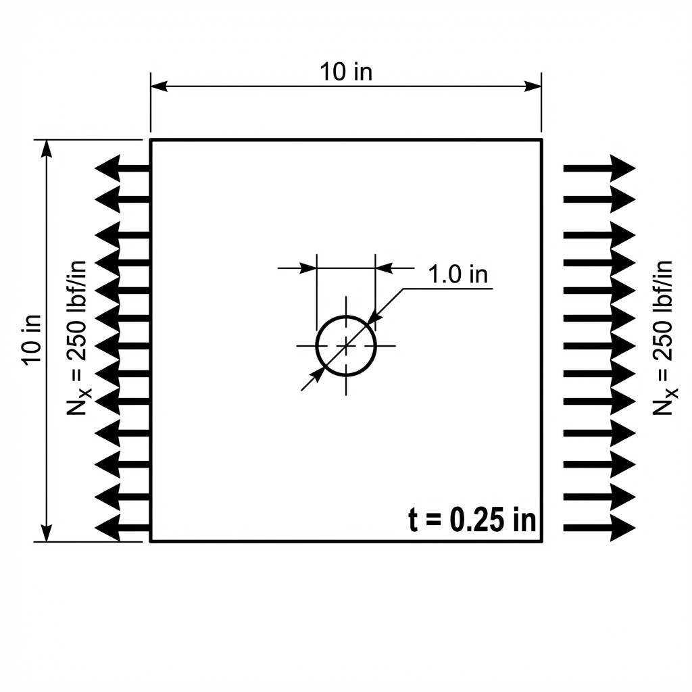

+++
date = '2026-10-23T12:00:00-04:00'
draft = true
title = 'Example Post: Images, Tables, and Math'
summary = 'A reference post showing every formatting feature this blog supports.'
tags = ['reference']
featured_image = 'fbd.png'
+++

This post is a **draft**, so it never appears on the live site. Run `hugo server -D` to see it locally,
and copy whatever you need from it into a real post.

## Images

The image file sits in the same folder as this `index.md`, so the path is just the file name:



## Tables

| Material      | E (GPa) | Yield (MPa) | Density (kg/m³) |
| :------------ | ------: | ----------: | --------------: |
| Al 7075-T6    |    71.7 |         503 |            2810 |
| Ti-6Al-4V     |   113.8 |         880 |            4430 |
| Steel 4130    |   205.0 |         460 |            7850 |

The colons in the divider row control alignment: `:---` is left, `---:` is right, `:---:` is centered.

## Math

Inline math goes between single dollar signs: the bending stress is $\sigma = \frac{M y}{I}$.

Display math goes between double dollar signs on their own lines:

$$
\delta_{max} = \frac{P L^3}{48 E I}
$$

Multi-line equations work too:

$$
\begin{aligned}
\sum F_x &= 0 \\
\sum M_A &= R_B L - P \frac{L}{2} = 0 \quad\Rightarrow\quad R_B = \frac{P}{2}
\end{aligned}
$$

To write a literal dollar sign (like \$50), put a backslash in front of it.

## Code

```python
import numpy as np

def bending_stress(M, y, I):
    return M * y / I
```

## Other Markdown

- **Bold**, *italic*, ~~strikethrough~~, and `inline code`
- [Links](https://gohugo.io/)
- Footnotes[^1]

> Block quotes look like this.

[^1]: The footnote text appears at the bottom of the post.
